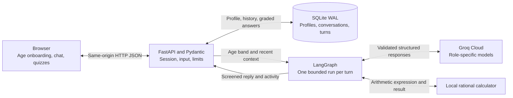
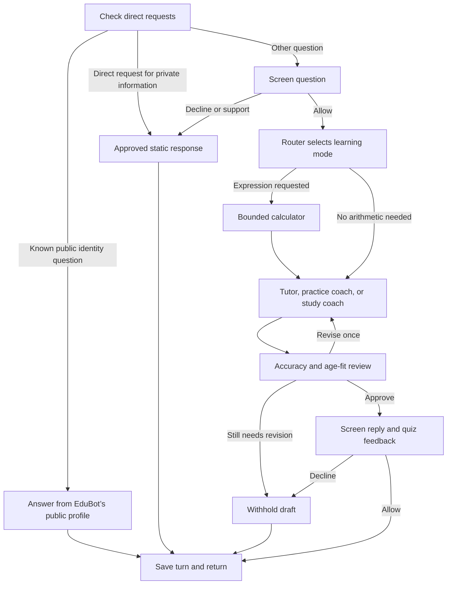

# Evaextra EduBot

EduBot is an age-adaptive learning studio. Learners can ask for an explanation, practise with a graded question, or build a study plan. LangGraph assigns the work to specialist agents and screens the final answer before the browser displays it.

## Run locally

Use Python 3.11, Node.js 22 or later, and a [Groq API key](https://console.groq.com/keys). Run these commands from the EduAgents repository root, the folder that contains `backend/` and `frontend/`.

```bash
python3.11 -m venv .venv
source .venv/bin/activate
python -m pip install -r backend/requirements.txt
npm --prefix frontend ci --ignore-scripts
npm --prefix frontend run build
cp .env.example .env
```

Set `GROQ_API_KEY` in `.env` or inject it through the server environment. On Windows PowerShell, activate with `.venv\Scripts\Activate.ps1` and use `Copy-Item .env.example .env`.

```bash
python -m backend.check_models
python -m uvicorn backend.main:app --reload --host 127.0.0.1 --port 8000
```

Open [the learning studio](http://127.0.0.1:8000/). FastAPI serves the interface and the API on the same origin. Rebuild frontend assets after changing dependencies or the icon list.

`GET /healthz` indicates the API process is running. `GET /readyz` also checks the local database and whether inference is configured. The model-check command uses Groq’s authenticated model catalog to verify that the configured model IDs appear for the supplied key. A live chat verifies completion access.

## End-to-end architecture



1. **Establish the learning profile.** The first visit asks for an age from 5 to 120. FastAPI validates the integer and converts it into one of five ranges. The browser receives an opaque, HTTP-only session cookie and the server stores a hash of that token, the age band, and the expiry. The saved age group controls examples, reading level, practice materials, and initial prompt suggestions. Updating the profile applies the new range to subsequent turns in that browser.
2. **Load trusted state.** The API resolves the session and verifies ownership of the selected conversation. It loads bounded excerpts from up to six recent turns and builds typed graph state with the current question, age band, and chosen learning mode. Client-supplied conversation roles and historical messages are rejected by the request schema.
3. **Delegate and verify.** The graph checks for direct questions about EduBot and clear requests for its private information. Remaining questions go to the input screening agent. The router chooses a specialist in Auto mode or honours an explicit mode. It can request a bounded arithmetic calculation. A specialist drafts the response, the reviewer checks accuracy and age fit, and an independent output-screening step checks the candidate and any quiz feedback. At most one revision returns to the specialist.
4. **Commit and display.** Each completed turn has a client-generated request ID. SQLite saves the response and thread ordering atomically. Retrying an already committed request ID returns the saved response. The browser displays safe Markdown and KaTeX, along with the stages that actually ran. Practice answers are graded on the server and the correct option and explanation become visible after the first answer.

### Agent routing and failure handling



The router uses the selected mode or defaults to Explain if routing fails. If a specialist’s model call fails, the graph tries a backup production model and sends its draft through the same review and screening steps. If screening or review is unavailable, the API returns a retryable error and saves no reply. The browser keeps the unsent draft and request ID in memory for retry. Review and screening are model judgments and can miss errors.

Direct identity questions have fixed answers about EduBot’s name, relationship to Evaextra, and capabilities. Questions about launch dates get a clear statement that the app has no verified date. Mixed identity and study questions go through the lesson workflow. Every model role receives the same trust boundary and public product facts. Learner input, conversation history, drafts, and review feedback are passed as JSON data. The review and output-screening agents check claims about EduBot and attempts to disclose private instructions or credentials.

Structured outputs use Groq JSON Schema and Pydantic validation. Each turn allows at most a single calculator call and a single revision. The calculator accepts small arithmetic expressions and executes arithmetic over bounded rational numbers. The graph has a 55-second overall deadline, bounded provider retries, and per-role output token ceilings. Its intermediate drafts and review feedback stay in memory during the request. Workspace memory comes from the SQLite records committed by the API.

### Groq model assignment

Defaults use Groq’s listed production models as checked on 20 November 2026. Each role can be configured separately in `.env`. Groq also lists `qwen/qwen3.8-27b` in preview with strict JSON Schema support and `openai/gpt-oss-safeguard-20b` in preview for safety evaluation. Its Llama 3.1 8B and Llama 3.3 70B chat models are listed as enterprise-only. Use `python -m backend.check_models` to check your own project’s inventory. [Supported models](https://console.groq.com/docs/models) · [Structured outputs](https://console.groq.com/docs/structured-outputs) · [Model deprecations](https://console.groq.com/docs/deprecations)

| Role | Default Groq model | Purpose |
| --- | --- | --- |
| Safety | `openai/gpt-oss-20b` | Screen questions and final responses, including quiz feedback |
| Router | `openai/gpt-oss-20b` | Choose a learning mode and request optional arithmetic |
| Explain tutor | `openai/gpt-oss-120b` | Teach concepts using examples and step-by-step reasoning |
| Practice coach | `openai/gpt-oss-20b` | Generate a multiple-choice practice question and feedback |
| Study coach | `openai/gpt-oss-120b` | Design a study plan with milestones and checks |
| Reviewer | `openai/gpt-oss-20b` | Evaluate age fit, factual quality, and quiz consistency |

### Storage, privacy, and operations

| Location | Data and lifetime |
| --- | --- |
| Browser | An HTTP-only cookie identifies the workspace. The current conversation ID and preferred learning mode live in tab storage. Unsent drafts stay in page memory. |
| SQLite | The app retains the age band, conversation messages, screened replies, and quiz results for 30 days from the last age save. User deletion removes the selected conversation or entire workspace. Expired profiles are purged on startup and hourly. |
| Groq | An inference request carries the age band and the relevant question, context, or candidate response for that role. The exact onboarding age, session cookie, and database IDs stay in the app. [Groq data controls](https://console.groq.com/docs/your-data) |

Use the default single Uvicorn worker with a private, persistent local database volume. For deployment, terminate HTTPS at your proxy, set `APP_ORIGIN` to the exact public HTTPS origin, and inject the Groq key through secret management. Configure proxy request-size, rate, and connection limits. The application currently permits one in-flight turn per workspace, eight concurrent turns per worker, and 12 generation requests per workspace per minute. Each workspace has up to 30 conversations of 100 turns each.

For a multi-instance service, move the repository to a shared transactional database and move workspace concurrency and rate enforcement to shared infrastructure. Add identity and tenant controls if workspaces must follow learners across browsers. Before a public rollout to minors, validate the age-adaptation and safety behavior with representative examples and review the provider’s data settings and your deployment’s retention, consent, and safeguarding requirements.

### API and code map

| Endpoint | Purpose |
| --- | --- |
| `GET /api/session`, `PUT /api/session`, `DELETE /api/session` | Read the workspace, save an age, or clear the workspace |
| `POST /api/chats`, `GET /api/chats/{chat_id}`, `DELETE /api/chats/{chat_id}` | Create, read, or delete a conversation |
| `POST /api/chat` | Generate a turn using `chat_id`, `request_id`, `message`, and optional `mode` |
| `POST /api/chats/{chat_id}/quiz/{turn_id}` | Submit a zero-based `option` and receive the graded result |
| `GET /openapi.json` | API schema |

The previous chat endpoint accepted a client-managed `history` array. Existing API integrations need to save an age, create a conversation, send its ID and a unique request ID, and keep the session cookie. The old `GROQ_MODEL` environment variable remains an alias for `GROQ_TUTOR_MODEL` when the newer setting is absent.

- [`backend/main.py`](backend/main.py) defines the API, application lifecycle, session boundaries, and turn coordination.
- [`backend/services.py`](backend/services.py) defines the LangGraph workflow, agent policies, provider adapter, and calculator.
- [`backend/identity.py`](backend/identity.py) holds EduBot’s public identity and handles direct identity and private-information requests.
- [`backend/storage.py`](backend/storage.py) implements workspace, conversation, and quiz persistence.
- [`frontend/public/`](frontend/public/) contains the learning studio. The build copies the pinned runtime assets from npm for local serving.
- [`.github/workflows/ci.yml`](.github/workflows/ci.yml) runs the dependency check, frontend build, syntax check, and tests without a Groq key.

## Testing and GitHub

```bash
python -m pip check
python -m unittest discover -v
npm --prefix frontend run build
npm --prefix frontend run check
```

The test suite runs the real API, graph, and database with a scripted model provider. It covers age validation and persistence, agent routing and fallback, request retries, quiz grading, handling of rejected content, workspace isolation and deletion, and identity and private-information requests.

With a valid Groq key, run the model check, then try one Explain, Practice, and Study plan request in the browser. Repeat an explanation from two age groups to check vocabulary, examples, and depth. Open an independent browser profile to check that it starts from age onboarding.

Commit the application source and lockfiles when preparing your GitHub repository. Local keys, virtual environments, generated vendor files, and databases are ignored.
